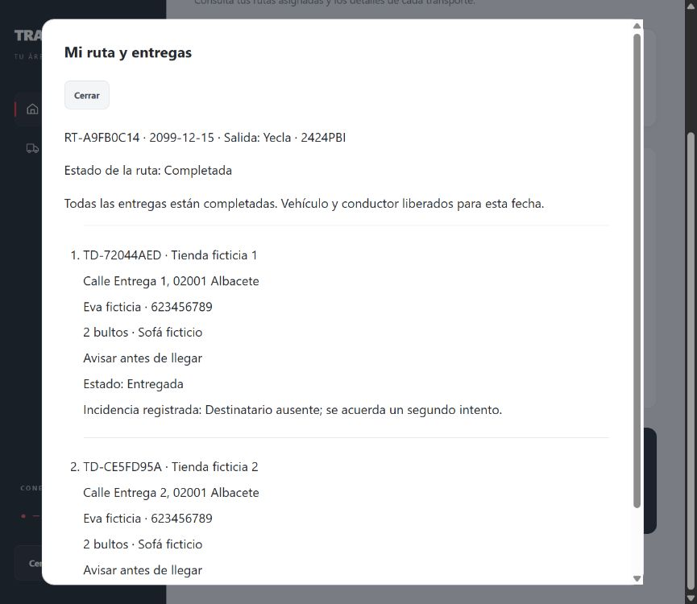

# P23 · Consultar ruta y actualizar entregas — T36/T37

RF-17. El conductor abre «Ver ruta y entregas» desde su listado, también para las rutas P22 ya existentes con itinerario completo. Muestra matrícula, salida, fecha, paradas en orden, destinatarios, direcciones, contactos, mercancía y observaciones. Las rutas antiguas sin itinerario informan del problema sin inventar datos.

## Estados acordados el 17/11/2026

El usuario aprobó iniciar ruta → en tránsito; entregar o registrar incidencia con motivo obligatorio por parada; resolver incidencia como entregada; completar y liberar reservas solo cuando todas las paradas estén entregadas.

| Acción | Precondición | Resultado |
|---|---|---|
| iniciar | Ruta planificada y solicitudes planificadas | Ruta, paradas y solicitudes en tránsito |
| incidencia | Ruta en tránsito, parada en tránsito, motivo de 1–1000 caracteres | Parada y solicitud con incidencia; ruta sigue activa |
| entregar | Ruta en tránsito, parada en tránsito o con incidencia | Parada y solicitud completadas |
| última entrega | Todas las paradas completadas | Ruta completada, inactiva, con fecha de finalización y reservas liberadas |

No se obliga a entregar en orden: el itinerario conserva el orden planificado. No se permite volver a estados anteriores, cambiar una entrega finalizada ni registrar de nuevo una incidencia abierta. El motivo previo se conserva como antecedente al resolverla. No se exige firma, fotografía ni geolocalización. No hay corrección administrativa o cancelación de rutas en este alcance.

## API y permisos

- GET `/api/conductor/rutas/:id`: itinerario completo propio y revisión operativa (0 para rutas anteriores).
- POST `/api/conductor/rutas/:id/actualizaciones`: `accion`, `revision`, `clave` única de operación; `solicitudId` para entregar/incidencia y `motivo` para incidencia.
- GET `/api/administracion/rutas/:id`: seguimiento de todas las paradas, estados y motivos.
- GET `/api/solicitudes/:id`: el cliente propietario ve estado e historial con el motivo; sin otras solicitudes de la ruta.

Sin sesión devuelve 401; cliente/administrador no pueden operar como conductor (403); otro conductor obtiene 404. El servidor relee la cuenta y comprueba la asignación. No acepta propietario, responsable ni estado impuestos por el navegador.

Cada operación conserva clave y contenido al reintentar. Repetir la misma clave y acción devuelve el estado actual sin otro evento; reutilizarla con datos distintos devuelve 409. Una clave nueva con revisión obsoleta devuelve 409. Tras un error de conexión la interfaz no confirma éxito y ofrece reintentar la misma operación; los errores conservan el motivo introducido. Cambiar de perfil o cerrar sesión limpia el detalle y descarta respuestas tardías.

SQLite aplica transacción inmediata. MongoDB usa transacción snapshot/majority y coordina la cuenta del conductor para detectar revocación concurrente. Cambiar ruta, solicitudes, historial y reservas es atómico. MongoDB libera reservas mediante `activa:false` y sus índices parciales; SQLite elimina solo las reservas de esa ruta. Una incidencia mantiene las reservas. No se altera el indicador general de disponibilidad del catálogo.

## Verificación

- `flujo-p24.test.js`: recorrido HTTP completo, permisos, transiciones, duplicados, revisiones obsoletas, solicitudes ajenas, concurrencia y reutilización de recursos tras terminar.
- `rutas-mongodb.test.js`: rollback real, inicio simultáneo con la misma clave sin duplicados, actualizaciones incompatibles con un ganador, múltiples paradas y persistencia completada entre procesos.
- `entregas-interfaz.test.js`: respuesta perdida con reintento idéntico, ausencia de confirmación prematura y descarte de respuesta tras cerrar sesión.
- Prueba visual local: dos paradas ficticias, inicio, incidencia vacía rechazada, incidencia con motivo, resolución, última entrega y consulta del historial por cliente.

