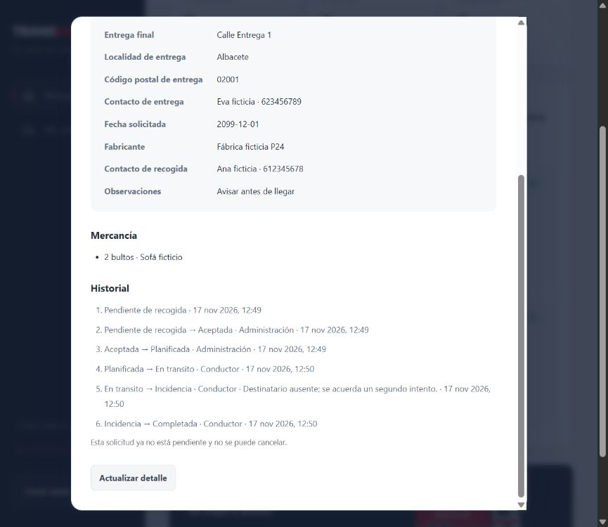

# P24 · Validación del flujo completo — T34/T35

T34 prepara cuentas, vehículo y solicitudes ficticias y recorre solicitud → aceptación → ruta → incidencia/entrega → consulta del cliente, comprobando persistencia. T35 automatiza permisos, fechas, duplicados y transiciones inválidas, y documenta modelo, API, demostración y evidencias. Numeración según DoneTonic: P24, T34 y T35. Los criterios CA24 del documento de Sprint 2 son propuestas; el acuerdo sobre estados P23 se confirmó con el usuario el 17/11/2026.

## Resultado del incremento

P23 incorpora el tramo que faltaba y se elimina el TODO de P24. El recorrido completo se ejecuta en `servidor/flujo-p24.test.js`, con incidencia y entrega, visibilidad por perfil y otra instancia HTTP que recupera sesión y datos completados de la misma BD. P15–P19 y P21–P24 tienen implementación y comprobaciones; la aceptación académica y el cierre del tablero corresponden al responsable. No se han cambiado estados en DoneTonic.

Base de este cambio: `a5e7e51`, rama `codex/p23-entregas-cierre-p24`. La versión exacta y el resultado remoto se consultan en el SHA y ejecución CI del PR. Entorno local del 17/11/2026: Windows, Node.js 24.21.0, npm 11.19.0, SQLite temporal, HTTP loopback y correo simulado. Regresión local: **85 casos, 83 superados, 0 fallos, 2 omitidos de MongoDB, 0 TODO**. Las omisiones locales no acreditan MongoDB; CI ejecuta las dos integraciones con replica set real, prueba el contenedor y conserva el informe JUnit `resultados-pruebas` descargable.

## Modelo y contrato

Cuenta → solicitud mediante `clienteId`; cuenta → recurso conductor mediante `usuarioId`; ruta → conductor mediante `conductorId` y → vehículo mediante `vehiculoId`. Cada parada conserva solicitud, orden, dirección, contacto, mercancía y estado. La ruta añade revisión y operaciones idempotentes. Cada solicitud conserva internamente ruta, revisión e historial; al cliente solo se devuelve su ámbito y los motivos de sus incidencias.

Estados: `pendiente_recogida → aceptada → planificada → en_transito → completada`, con alternativa `en_transito → incidencia → completada`. La ruta se completa cuando todas sus paradas están entregadas, liberando reservas de vehículo y conductor. Incidencias abiertas mantienen la ruta activa. Las pendientes permiten cancelación o rechazo con motivo. Ver [P23: estados, API y permisos](P23-entregas.md).

| Operación | API | Esperado y observado |
|---|---|---|
| Alta y reintento | POST `/api/solicitudes`, `Idempotency-Key` | 201; reintento 200, mismo ID; datos distintos 409 |
| Recursos | POST `/api/administracion/vehiculos` y `/conductores` | 201, recursos asignables |
| Aceptación | POST `/api/administracion/solicitudes/:id/revision` | 200, historial coherente |
| Planificar | POST `/api/administracion/rutas` | 201, guardado atómico |
| Pendiente o conflicto de reserva | POST rutas | 409, sin cambios parciales |
| Fecha pasada/imposible, paradas duplicadas | POST rutas | 400, sin ruta parcial |
| Ruta propia/ajena | GET `/api/conductor/rutas/:id` | 200/404; cliente y administrador 403 |
| Inicio, incidencia, resolución | POST `/api/conductor/rutas/:id/actualizaciones` | 200, estados e historial actualizados |
| Sin sesión, rol falsificado, solicitud ajena | APIs protegidas | 401/403/404 según ámbito |
| Acción desconocida/incidencia sin motivo | POST actualización | 400 |
| Revisión obsoleta/transición inválida | POST actualización | 409, sin sobrescritura |
| Respuesta perdida y reintento | POST actualización | Misma clave, sin duplicar evento |
| Escrituras incompatibles | HTTP y transacción MongoDB | Un ganador y un conflicto |
| Última entrega | POST actualización | Ruta completada e inactiva; recursos reutilizables |
| Consulta cliente/administración | GET solicitud/ruta administrativa | Estado, motivo e historial persistidos |
| Persistencia entre procesos | Nuevas instancias SQLite y MongoDB | Recuperan estados completados y paradas |
| Cancelar pendiente/repetir/planificada | POST cancelación | 200/409/409, sin duplicar historial |

`entregas-interfaz.test.js` verifica fallo de red y respuesta tardía tras cerrar sesión. Las suites de solicitudes, revisión y rutas amplían validaciones, recursos revocados, concurrencia y rollback. MongoDB comprueba que un fallo de inicio no cambia parcialmente ruta ni otra solicitud y se reabre en otro proceso tras completar las paradas.

## Reproducir las pruebas

Desde la raíz: `npm test`. Para las nuevas pruebas, desde `servidor`:

```powershell
node --require ./entorno-pruebas.cjs --test flujo-p24.test.js entregas-interfaz.test.js
```

Los datos usan `example.com`, confirmación simulada, teléfonos ficticios y fechas de diciembre de 2099; cada proceso crea su BD temporal. No se carga `.env` ni se utilizan cuentas de producción. MongoDB local requiere `MONGODB_TEST_URL` con host local, base `pruebas_*` y replica set. En CI esa configuración ya existe.

## Demostración visual reproducible

Desde la raíz ejecutar `node servidor/demo-p24.cjs` y abrir `http://127.0.0.1:3087`. Crea una BD temporal con administrador, cliente, conductor, camión y ruta con dos solicitudes completas. Cuentas de demostración: `admin-p24@example.com`, `cliente-p24@example.com` y `conductor-p24@example.com`; contraseña exclusiva de esta demo desechable: `clave-prueba`. No son accesos de la web pública. Detener el proceso al terminar.

1. Como conductor, abrir «Ver ruta y entregas» y comprobar las dos paradas, direcciones, contactos y mercancía.
2. Pulsar «Iniciar ruta». Intentar una incidencia vacía: exige motivo. Registrar un motivo ficticio en la primera parada.
3. Resolverla como entregada. La ruta sigue en tránsito mientras la segunda parada esté pendiente.
4. Entregar la segunda parada. La ruta figura completada y avisa de la liberación de recursos.
5. Cerrar sesión, entrar como cliente y abrir ambas solicitudes: completadas; el historial conserva tránsito, incidencia, motivo y resolución.
6. Administración puede ver seguimiento en el itinerario y detalle de solicitud; puede planificar otra ruta con esos recursos en esa misma fecha.

Se ejecutaron visualmente los pasos 1–5 el 17/11/2026 en navegador local. Referencias: ruta `RT-A9FB0C14`, solicitudes `TD-72044AED` y `TD-CE5FD95A`. Esperado y observado coinciden: dos entregas completadas y motivo conservado. Consulta administrativa, liberación de recursos y persistencia se comprueban automáticamente. La demo parte de datos aceptados/planificados; alta y aceptación se recorren por HTTP en T34. No se presentan como alta visual manual.



## Trazabilidad y revisión

- T34 / CA24-01: recorrido completo por perfiles con incidencia y entrega; RF-10 a RF-17.
- CA24-03: persistencia entre procesos SQLite y MongoDB; datos desechables en pruebas aisladas.
- T35 / CA24-02: permisos, fechas, duplicados, conflictos y transiciones inválidas.
- CA24-04: versión, entorno, entradas, esperado/observado, CI JUnit y capturas.
- CA24-05: README, modelo, API, demostración, seguimiento de memoria y documentos P23/P24 actualizados.

No se detectaron defectos funcionales pendientes en este recorrido. Límites: no mapas, optimización, firma/fotos/geolocalización, cancelación/corrección administrativa de rutas, conversión de bultos a capacidad ni edición de solicitudes antiguas incompletas. Las rutas anteriores con itinerario completo se pueden ejecutar; sin él muestran aviso. No se modificaron datos operativos reales para demostrar el cierre. Correo/Google se simulan y no acreditan recepción/consentimiento real; tampoco se acredita aquí un reinicio manual de Cloud Run. La aceptación final no cambia automáticamente DoneTonic ni Overleaf.
