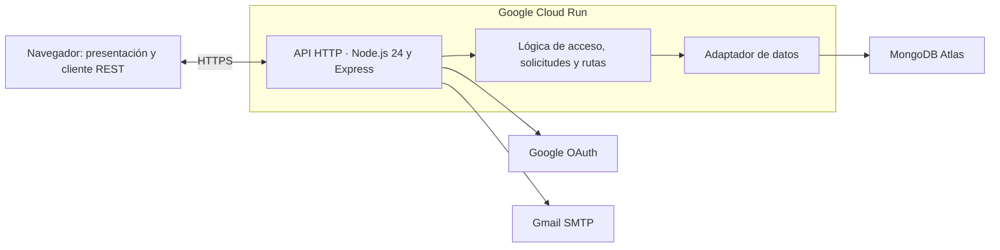

# Arquitectura de TransDrakkar

| Capa | Responsabilidad | Código |
| --- | --- | --- |
| Presentación | Formularios, paneles por rol, planificación y actualización de entregas. | [cliente](../cliente) |
| Comunicación | Peticiones HTTP y sondeo de listados entre perfiles. | [rest.js](../cliente/rest.js) |
| API | Validación de la petición, sesión y respuesta HTTP. | [api.js](../servidor/api.js) |
| Negocio | Reglas de cuentas, solicitudes, asignación y estados. | [logica.js](../servidor/logica.js), [solicitudes.js](../servidor/solicitudes.js), [rutas.js](../servidor/rutas.js) |
| Persistencia | Contrato asíncrono y adaptadores. MongoDB sirve la aplicación y SQLite se usa en pruebas aisladas. | [datos.js](../servidor/datos.js), [datos-mongodb.js](../servidor/datos-mongodb.js), [datos-sqlite.js](../servidor/datos-sqlite.js) |

MongoDB conserva cuentas, sesiones, confirmaciones, operaciones OAuth, solicitudes, recursos y rutas. La planificación reserva vehículo y conductor por fecha y actualiza las solicitudes en una transacción. El itinerario conserva los datos de cada parada en el orden asignado.

La API aplica rol y propiedad en el servidor. La sesión usa una cookie HttpOnly y el servidor conserva el hash del token. Los secretos del despliegue se gestionan en Secret Manager.

Consulta la [guía de despliegue](../DESPLIEGUE-GOOGLE-CLOUD.md) y las [decisiones de diseño](decisiones.md).
