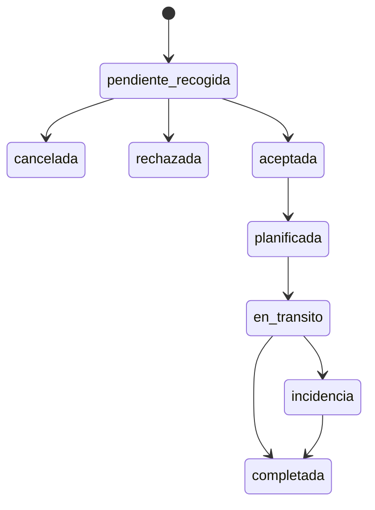

# Procesos

## Acceso a la aplicación

1. El cliente crea una cuenta con nombre, primer apellido, correo y contraseña.
2. Confirma el correo mediante el enlace recibido e inicia sesión. Si Google está configurado, puede acceder con ese proveedor o vincularlo a una cuenta local existente acreditando su contraseña.
3. El servidor comprueba el perfil y muestra el panel correspondiente. Administración puede habilitar como conductor a un cliente confirmado. Incorporarlo al catálogo de recursos requiere un paso adicional.

## Transporte de mobiliario

1. El cliente registra la recogida en Yecla con los datos completos del destinatario. Puede cancelar mientras la solicitud está pendiente.
2. Administración acepta la solicitud o la rechaza con un motivo visible para el cliente.
3. Administración elige vehículo y conductor disponibles de Yecla, fija la fecha y ordena las paradas de las solicitudes aceptadas.
4. El conductor asignado inicia la ruta y registra cada entrega o incidencia. Una incidencia puede resolverse como entregada.
5. La última entrega completa la ruta y libera las reservas. El cliente consulta el estado y el historial de su propia solicitud.

Consulta el [recorrido P24](anexos/P24-validacion-flujo.md) para reproducir el proceso con datos ficticios.

## Desarrollo y verificación

1. Relacionar el cambio con su PBI y acordar el comportamiento esperado.
2. Crear una rama `codex/` antes de editar, seguir la separación por capas y actualizar la documentación que corresponda.
3. Ejecutar `npm test` y preparar un pull request con el cambio y la forma de verificarlo.
4. Revisar el PR y comprobar [GitHub Actions](../.github/workflows/ci.yml) antes de integrarlo en `main`. Cloud Build despliega los commits integrados según la [configuración del proyecto](../cloudbuild.yaml).

Para verificar despliegue, correo real, Google o la sincronización entre navegadores, aplica los pasos de la [guía de evaluación](anexos/GUIA-EVALUACION.md).
